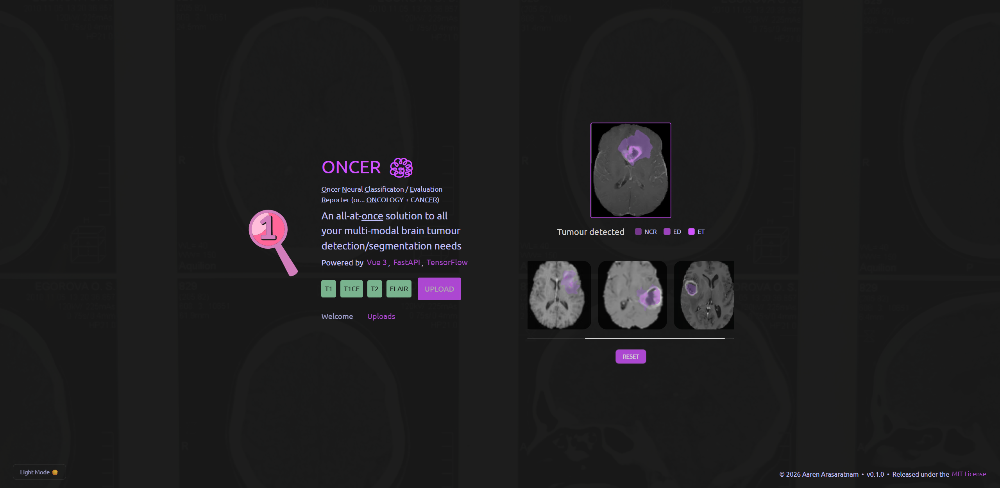

ONCER is a web-based deep learning tool for automated multi-parametric **brain tumour segmentation**, trained on the [2021 RSNA-ASNR-MICCAI BraTS Challenge](https://www.cancerimagingarchive.net/analysis-result/rsna-asnr-miccai-brats-2021/) Task 1 dataset. The model (`api/models/oncer_model.keras`) is a ResU-Net, i.e., a convolutional neural network architecture built around an encoder-decoder structure with skip connections. 

It processes co-registered, skull-stripped, 4-channel structural MRI scans (`T1`, `T1CE`, `T2`, `FLAIR`) to delineate sub-tumoural structures like **Gadolinium-enhancing tumour (ET)**, **peritumoural edematous/invaded tissue (ED)**, and **necrotic tumor core (NCR)**. Dataset 
images were annotated manually by neuro-radiologists and resampled to isotropic 1 mm<sup>3</sup> resolution, as documented in [this paper](https://ieeexplore.ieee.org/document/6975210) (see `docs`).

I started this in September 2024 after messing around with Keras/TensorFlow and getting reeeeally into brain MR imaging after wrapping up a co-op placement.

## Prerequisites
This section covers what's needed for **GPU-accelerated model training** with **NVIDIA GPUs**, but because 
the model file is already provided in this repository, feel free to jump ahead to [Running Locally](#running-locally).

To avoid compatibility issues with the latest NVIDIA GPUs *(and the ensuing CUDA/cuDNN mismatch headaches)*, I used **[NVIDIA NGC containers](https://catalog.ngc.nvidia.com/orgs/nvidia/containers/tensorflow)**
(`nvcr.io/nvidia/tensorflow:25.02-tf2-py3`). The one specified in `api/Dockerfile` comes pre-packaged with
Python **3.12**, TensorFlow **2.17.0** (Keras **3**), CUDA **12.8.0** / cuDNN **9.7.1**, and Ubuntu 
**24.04.1 LTS**, which're guaranteed to work together out of the box. Because these containers are Linux-based, you'll need [WSL2](https://learn.microsoft.com/en-us/windows/wsl/install) installed for Windows (Ubuntu **22.04 LTS** recommended). 

You'll naturally want to have [Docker Desktop](https://www.docker.com/products/docker-desktop/),
the [NVIDIA Container Toolkit](https://docs.nvidia.com/datacenter/cloud-native/container-toolkit/latest/install-guide.html) (lets Docker use your GPU), and latest [NVIDIA drivers](https://www.nvidia.com/en-us/drivers/) for your GPU installed as well!

The training data can be downloaded from Kaggle, [here](https://www.kaggle.com/datasets/dschettler8845/brats-2021-task1/data). Note the following disk requirements: the raw dataset uses **12.4** GB, the processed data takes **22.6** GB, and the compiled `oncer-api` Docker image takes **28-31** GB, for a combined **63-66** GB of disk space needed to run the full training pipeline.

## Setup
Begin by cloning the repository and navigating to the project directory:

```bash
git clone https://github.com/aaren-aras/oncer.git 
cd oncer
```

### Model Training
Verify your installations before proceeding:

```bash
docker run --rm --gpus all nvidia/cuda:12.2.0-base-ubuntu22.04 nvidia-smi
```

Extract the `BraTS2021_Training_Data` folder from `archive.zip > BraTS2021_Training_Data.tar`.

Then, inside the `api` directory, create a new folder, name it `data`, and move the `BraTS2021_Training_Data` folder into `data` (i.e., `api/data/BraTS2021_Training_Data`).
This ensures the `data.py` and `model.py` scripts in `api/src/scripts` can find the 
dataset without extra setup. 

Launch **Docker Desktop**, and while inside `api`, build the `oncer-api` image, and spin up a container:

```bash
cd api
docker compose up --build
```

Clean up build cache afterwards with `docker builder prune -a`, and close the container after use with `docker compose down`.

### Running Locally
From the project root, create a `.env` file and set port numbers and host bindings for the frontend 
and backend dev servers *(this is optional as defaults are provided, **but still recommended**)*. 
For example:

```bash
APP_PORT=5173
API_PORT=5000
API_HOST=0.0.0.0
```

Commands for interfacing with the **frontend** dev server (`https://localhost::${APP_PORT}`) are listed 
in `app/package.json` under `scripts`. Install all dependencies and run it from the `app` directory:

```bash
cd app 
npm install
npm run start
```

The **backend** dev server (`https://localhost:${API_PORT}`) uses **[uvicorn](https://uvicorn.dev/)**, 
and can be run from the `api` directory after installing core dependencies (see `api/pyproject.toml`) 
in a virtual environment. Note that Python **3.11**/**3.12** is required:

```bash
cd api
py -3.12 -m venv .venv # Git Bash example 
source .venv/Scripts/activate 
pip install .
uvicorn src.main:app --host "$API_HOST" --port "$API_PORT" --reload
```

### Using the App
With the dev servers set up, you'll be able to test out the model. Segmentation accuracy depends
heavily on matching the preprocessing pipeline in `api/scripts`. For the best results, upload all 
four **co-registered**, **skull-stripped**, **axial** slices (`T1`, `T1CE`, `T2`, `FLAIR`) 
simultaneously as **PNGs** *(to avoid compression artifacts on subregion boundaries)*, ideally 
resampled to $1\text{ mm}^3$ isotropic voxel resolution to match the BraTS 2021 training distribution
mentioned earlier. 

This dataset also consists exclusively of **gliomas**, so any attempt to segment other brain 
pathologies like meningiomas, pituitary adenomas, or stroke lesions will be met with varying, unpredictable, unreliable degrees of success. Enjoy!

## Retrospective
 - TF GPU compatibility is fragile outside Docker NGC containers, only guaranteed up to
  **2.10 (CUDA 11.2, cuDNN 8.1)** for Windows, and strongly recommended for newer GPUs 
  (RTX 40/50 series) requiring CUDA **12+** 
    - Some TF builds lack precompiled CUDA kernels for newer GPUs with higher compute capabilities, forcing them to JIT-compile PTX at runtime, which drastically slows startup
    - NGC containers avoid the issue by including prebuilt, GPU-optimized binaries
 - Scope creep is real  