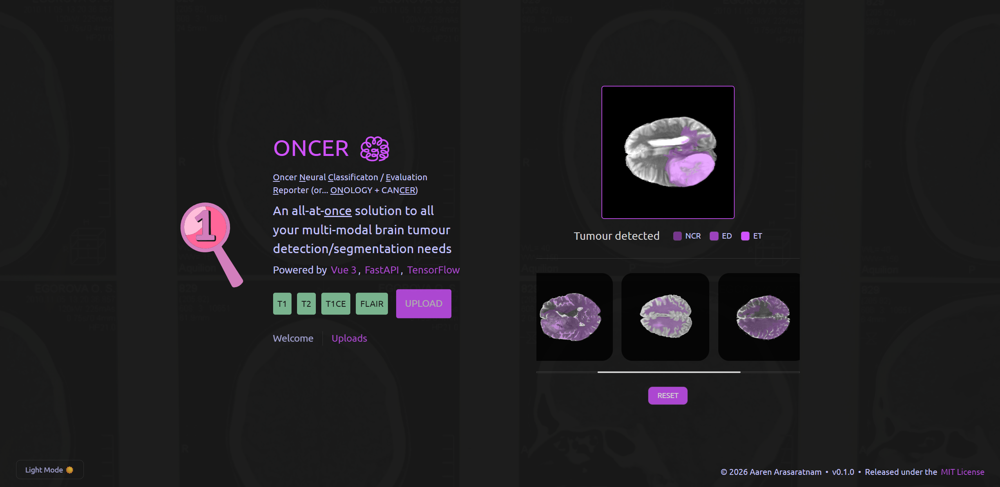

ONCER is a web-based deep learning tool for automated multi-parametric **brain tumour segmentation**, trained on the [2021 RSNA-ASNR-MICCAI BraTS Challenge](https://www.cancerimagingarchive.net/analysis-result/rsna-asnr-miccai-brats-2021/) Task 1 dataset. The model (`api/models/oncer_model.keras`) is a ResU-Net, i.e., a convolutional neural network architecture built around an encoder-decoder structure with skip connections. 

It processes co-registered, skull-stripped, 4-channel structural MRI scans (`T1`, `T1CE`, `T2`, `FLAIR`) to delineate sub-tumoural structures like **Gadolinium-enhancing tumour (ET)**, **peritumoural edematous/invaded tissue (ED)**, and **necrotic tumor core (NCR)**. Dataset 
images were annotated manually by neuro-radiologists and resampled to isotropic 1 mm<sup>3</sup> resolution, as documented in [this paper](https://ieeexplore.ieee.org/document/6975210).

I started this in September 2024 after messing around with Keras/TensorFlow and getting reeeeally into brain MR imaging after wrapping up a co-op placement.

## Prerequisites
This section covers what's needed for **GPU-accelerated model training**, but because the model file is already provided in this repository, feel free to jump ahead to [Running Locally](#running-locally). 

To avoid compatibility issues with the latest NVIDIA GPUs *(and the ensuing CUDA/cuDNN mismatch headaches)*, I used **[NVIDIA NGC containers](https://catalog.ngc.nvidia.com/orgs/nvidia/containers/tensorflow)**
(`nvcr.io/nvidia/tensorflow:25.02-tf2-py3`): Docker containers that come pre-packaged with versions of TensorFlow, CUDA, and cuDNN that're guaranteed to work together out of the box. Because these containers are Linux-based, you'll need [WSL2](https://learn.microsoft.com/en-us/windows/wsl/install) installed for Windows (Ubuntu **22.04** recommended). 

You'll naturally want to have [Docker Desktop](https://www.docker.com/products/docker-desktop/),
the [NVIDIA Container Toolkit](https://docs.nvidia.com/datacenter/cloud-native/container-toolkit/latest/install-guide.html) (lets Docker use your GPU), and latest [NVIDIA drivers](https://www.nvidia.com/en-us/drivers/) for your GPU installed as well!

The training data can be downloaded from Kaggle, [here](https://www.kaggle.com/datasets/dschettler8845/brats-2021-task1/data). Note the following disk requirements: the raw dataset uses **12.4** GB, the processed data takes **22.6** GB, and the compiled `oncer-api` Docker image takes **31.1** GB, for a combined ~**66** GB of disk space needed to run the full training pipeline.

## Setup
Start by verifying your Docker setup:

```bash
docker run --rm --gpus all nvidia/cuda:12.2.0-base-ubuntu22.04 nvidia-smi
```

```bash
# Clone repo and navigate to project dir
git clone https://github.com/aaren-aras/oncer.git && cd oncer
```

### Setting up folder structure 
Inside the `api` directory, create a new folder, name it `data`, and place the unzipped `BraTS2021_Training_Data` folder inside `data` (like so: `api/data/BraTS2021_Training_Data`).
This ensures the `preprocessing.py` and `model.py` scripts in `api/src/scripts` can find the dataset without any additional configuration. These steps ensure that the `preprocessing.py` and `model.py` scripts in `api/src/scripts` can find the dataset without additional configuration.


From the project **root**, create a `.env` file and set a port number for the backend (e.g., `5000`):


```
API_PORT=5000
```

Then, run the following:

```bash
chmod +x api/entrypoint.sh
```


After launching **Docker Desktop**:

```bash
# Build backend image and run locally (available @ https://localhost:${API_PORT})
cd api && docker compose up --build
```

You can close the container with `docker compose down`. 

### Option B: Local 
Alternatively, if you don't want to use Docker/NGC, you could set up Python, TensorFlow, [CUDA](https://developer.nvidia.com/cuda-toolkit-archive), and [cuDNN](https://developer.nvidia.com/rdp/cudnn-archive) manually from your end. This means YOU are responsible for making sure ALL software versions play nicely together, a fate I personally wouldn't wish on my worst enemy (but hey, the choice is yours). 

Refer to this [table](https://www.tensorflow.org/install/source#gpu) for tested build configurations.

#### Sidenotes
 - TensorFlow GPU support outside containers is only guaranteed up to **2.10 (CUDA 11.2, cuDNN 8.1)** for Windows
 - If you have a newer GPU (e.g., RTX 40/50 series), containers are STRONGLY recommended

```bash
cd api

# Install Python deps within virtual env (Windows example)
py -3.10 -m venv .venv
source .venv/Scripts/activate # Git Bash
pip install -r requirements.txt

# Run backend
./entrypoint.sh
```

### Running Locally
In another terminal:

```bash
# Install Node.js deps 
cd ../app && npm install

# Launch dev instance (frontend)
npm run start

# Build and preview prod instance
npm run build
npm run preview
```

An `API_PORT` must be set in a root `.env` file for `entrypoint.sh` to run the backend. E.g.,

```bash
API_PORT=5000
```

### Issues
 - TF GPU compatibility is fragile outside Docker NGC containers
 - Windows requires WSL2 for Docker GPU acceleration

## Retrospective
 - Please stop falling for **scope creep**
 - KNOW your **tools**, and when/how/why to use them given the scope
   - Consider writing the entire backend in Python for all future DL projects
 - Docker NGC containers MASSIVELY simplify GPU + CUDA setup for modern NVIDIA GPUs requiring CUDA 12+ (no version mismatch and local rebuild trial-and-error, no Bazel errors, no DLL errors, ...)
   - Don't waste time with local installs and juggling Python versions, CUDA toolkits, and cuDNN DLLs on Windows when there're cleaner solutions available
   - You don't have to use *older* versions of software to achieve compatibility
   - Some TF builds lack precompiled CUDA kernels for newer GPUs with higher compute capabilities, forcing them to JIT-compile PTX at runtime, which can drastically slow startup; these containers avoid the issue by including prebuilt, GPU-optimized binaries
 - Look into multi-GPU setups (distributed training?): https://developer.nvidia.com/nccl
 - Implement model in PyTorch with [ONNX](https://github.com/onnx/onnx)
